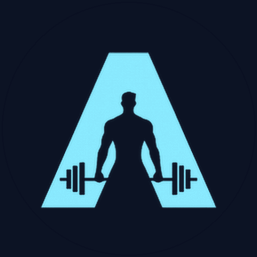

<p align="center">
  
</p>

<h1 align="center">Ammutta for iOS</h1>

<p align="center">
  A focused workout tracker for iPhone.<br>
  <strong>Free. No ads. No accounts. Your data stays on your iPhone.</strong><br>
  English · Italiano
</p>

---

Ammutta ("push!" in Sicilian) lets you build workout plans, run them set by set with rest and exercise timers, and keep a complete training history, without handing your data to anyone.

> **Status:** first prototype (0.1). Plans, guided workouts with in-app rest and exercise timers, history and settings, in English and Italian. Lock Screen alerts, Live Activity, Bluetooth heart rate, Apple Health, sharing and export come next.

## What it does

- **Exercise library:** a built-in, localized catalog plus your own exercises, tracked by **reps (with optional weight)** or by **duration**.
- **Plans with per-set targets:** different reps, weight or time for every set, with configurable rest.
- **Guided workouts:**
  - one-tap set logging, editable inline until you finish;
  - automatic rest timers;
  - countdowns for timed sets.
- **Timers you can trust on the Lock Screen:** AlarmKit alerts, falling back to time-sensitive notifications, plus a Live Activity with quick actions.
- **Bluetooth heart rate:** any standard BLE heart-rate sensor (chest straps, armbands) and **Google Fitbit Air** with "Share heart rate" turned on.
- **History and progress:** every set with timestamps, last performance and personal bests per exercise.
- **Apple Health (optional):** completed workouts and heart rate written on device, kept in sync when you edit or delete.
- **Plan sharing:** links, QR codes, files and CSV. They carry plan structure only, never personal data.
- **Your data, your files:** full export and import, and delete everything at any time.

The full behavior is specified in **[docs/product-spec.md](docs/product-spec.md)**.

## Principles

| | |
| --- | --- |
| **Local-only** | No server, no login, no cloud sync, no analytics or crash SDKs. The app contains no networking code. App Store privacy label: *Data Not Collected* |
| **Free** | No purchases, subscriptions, ads or paywalls. Every feature for everyone |
| **Multilingual** | Ships in English and Italian from day one. Built-in exercise names are localized too, and more languages need only translations |
| **Nothing is required** | Works fully without Bluetooth, Apple Health, notifications or alarms |
| **No dependencies** | Apple SDKs only |

## Technical overview

- iPhone, **iOS 26+**, Swift 6, SwiftUI with Observation, SwiftData;
- AlarmKit, ActivityKit, CoreBluetooth and HealthKit;
- XcodeGen project, with a modular local Swift package;
- a pure, fully unit-tested domain core and workout engine.

Details: **[docs/architecture.md](docs/architecture.md)**.

## Repository layout

```
ios/
  project.yml       XcodeGen spec (the .xcodeproj is generated, never committed)
  App/              SwiftUI app: screens, app model, string catalogs, assets
  Packages/AmmuttaKit/
    AmmuttaCore         pure domain + workout engine (Foundation only)
    AmmuttaPersistence  SwiftData storage
  Tests/            app unit tests and UI tests
.github/workflows/
  ci.yml            pipeline safety tests, strings check, core tests on Linux, native build + en/it tests
  testflight.yml    manual, main-only: signed archive, or explicit TestFlight upload
scripts/            signing, archive, bundle-rule checks, simulator tests + offline test harness
docs/
  product-spec.md   what the app does (source of truth)
  architecture.md   how it is built
  testflight.md     Apple + GitHub setup for TestFlight
branding/           logo
AGENTS.md           guidance for coding agents working in this repo
```

## Development

Checks that run anywhere with Python 3:

```sh
python3 scripts/check-strings.py                                   # en/it string catalogs complete
python3 -m unittest discover -s scripts -p 'test_testflight_ci.py' -v
```

Domain core tests (any OS with Swift 6.2, including Linux):

```sh
swift test --package-path ios/Packages/AmmuttaKit
```

The app (macOS, Xcode 26.6+, `brew install xcodegen`):

```sh
cd ios && xcodegen generate && open Ammutta.xcodeproj
./scripts/test-ios.sh            # unit + UI tests in English and Italian
```

Without a Mac, push a branch or open a pull request: CI builds the app, runs every test in both languages and uploads simulator screenshots as the `ios-screenshots` artifact.

Shipping to TestFlight: see **[docs/testflight.md](docs/testflight.md)**.
