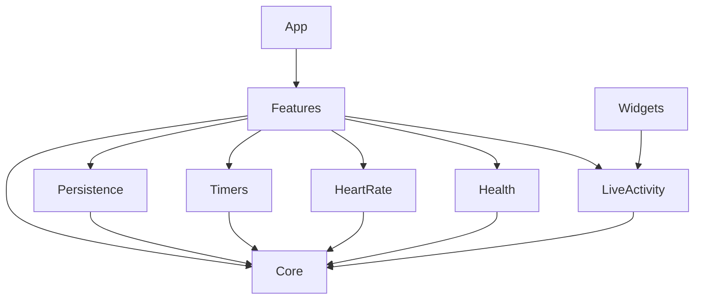

# Ammutta for iOS — Architecture

Status: **design only**. This describes the system to build from scratch. There is no legacy data, format or API to stay compatible with.

## 1. Goals

1. **Correct under interruption.** Workouts and timers survive suspension, termination, reboots and denied permissions.
2. **Local-only by construction.** No module can make network requests. Every outbound flow (Health, share, export) is explicit and user-initiated.
3. **Testable core.** Domain rules, the workout engine, codecs and parsers are pure Swift with no Apple-framework side effects. They are exhaustively unit-tested.
4. **Replaceable edges.** Persistence, Bluetooth, HealthKit, alarms and Live Activities sit behind small protocols, so each has a fake for tests and previews.
5. **No third-party dependencies.** Apple SDKs only.

## 2. Stack

| Concern | Choice |
| --- | --- |
| Language | Swift 6 language mode, strict concurrency checking |
| UI | SwiftUI, Observation (`@Observable`), `NavigationStack` with typed routes |
| Persistence | SwiftData with `VersionedSchema` + `SchemaMigrationPlan` from v1 |
| Timers / alerts | AlarmKit, with a `UserNotifications` fallback |
| Lock Screen | ActivityKit Live Activity + App Intents (widget extension) |
| Heart rate | CoreBluetooth (Heart Rate Service `0x180D`) |
| Health | HealthKit (write-only in v1) |
| QR | CoreImage `CIQRCodeGenerator` |
| Compression | Apple `Compression` framework |
| Tests | Swift Testing (unit), XCTest/XCUITest (UI) |
| Project | XcodeGen `ios/project.yml`. The `.xcodeproj` is generated and never committed |

## 3. Module layout

There is one local Swift package with several library targets, plus a thin app target and a widget extension. Dependencies point **inward only**.

```
ios/
  project.yml                 XcodeGen: Ammutta app, AmmuttaWidgets extension, test targets
  App/                        @main, composition root, Info.plist, entitlements, assets
  Widgets/                    Live Activity + AlarmKit countdown presentation, App Intents
  Packages/AmmuttaKit/
    Sources/
      AmmuttaCore/            Pure domain: models, rules, workout engine, codecs, formatting
      AmmuttaPersistence/     SwiftData schema, migrations, repositories
      AmmuttaTimers/          AlarmKit + notification fallback behind TimerAlerting
      AmmuttaHeartRate/       CoreBluetooth sensor service behind HeartRateSource (prototype: app target)
      AmmuttaHealth/          HealthKit writer + durable sync queue behind HealthSyncing
      AmmuttaLiveActivity/    ActivityKit attributes and controller (shared with Widgets)
      AmmuttaFeatures/        SwiftUI screens and their @Observable models
    Tests/                    One test target per library target
  Resources/
    Localizable.xcstrings     UI strings (en + it)
    InfoPlist.xcstrings       Permission purpose strings (en + it)
    Exercises.xcstrings       Built-in exercise names, technique tips, muscles worked, equipment, muscle groups (en + it)
    PrivacyInfo.xcprivacy     No tracking, no collected data
```



`AmmuttaCore` imports only Foundation. It must never import SwiftUI, SwiftData, CoreBluetooth, HealthKit, ActivityKit or AlarmKit.

## 4. Domain model (`AmmuttaCore`)

All domain types are value types (`struct`/`enum`), `Sendable`, `Codable` and `Equatable`.

### 4.1 Identity and units

- IDs are typed wrappers around `UUID`: `ExerciseID`, `PlanID`, `WorkoutID` and so on. This prevents mixing them up.
- **Weight is stored as integer grams** (`Mass(grams: Int)`), which avoids floating-point drift. Conversion to kg or lb happens only at the formatting edge, and lb input is rounded to the nearest 0.25 lb then stored in grams.
- **Durations are integer seconds** (`Seconds`) for targets and logs. Deadlines are `Date`.

### 4.2 Types

```swift
enum TrackingKind { case reps, duration }

enum ExerciseRef: Hashable, Codable {   // what plans and logs point at
  case builtIn(key: String)             // localized at display time
  case custom(ExerciseID)
}

struct CustomExercise { id, name, kind, equipment?, muscleGroup?, isArchived }
struct BuiltInExercise { key, kind, equipment, muscleGroup }   // ExerciseCatalog.swift

enum SetTarget { case reps(count: Int, weight: Mass?), duration(Seconds) }

struct PlanExercise { id, exercise: ExerciseRef, rest: Seconds, sets: [SetTarget] }
struct Plan { id, name, exercises: [PlanExercise], healthActivity: HealthActivityKind, createdAt, updatedAt }

enum SetOutcome { case pending, logged(SetResult, at: Date), skipped(at: Date) }
enum SetResult { case reps(count: Int, weight: Mass?), duration(Seconds) }

struct WorkoutExercise { id, exercise: ExerciseRef, nameSnapshot: String?, kind, rest, sets: [WorkoutSet] }
struct WorkoutSet { id, target: SetTarget, outcome: SetOutcome }

struct Workout {
  id, planID?, planNameSnapshot, startedAt, endedAt?,
  exercises: [WorkoutExercise], heartRate: [HeartRateSample], timer: ActiveTimer?
}
enum ActiveTimer { case rest(exerciseIndex, setIndex, endsAt: Date), work(exerciseIndex, setIndex, startedAt: Date, endsAt: Date) }
```

- A workout **copies** plan data when it starts (`WorkoutExercise` instead of a reference to `PlanExercise`), so plan edits never affect workouts.
- `nameSnapshot` is set only for custom exercises. History shows the current custom name, with the snapshot as the fallback if the exercise is later deleted. Built-in names are always localized live.
- Validation lives in the core as throwing initializers / `validate()`. The ranges come from the product spec, and the UI, importers and persistence share the same rules.

### 4.3 Workout engine

The active workout is driven by a **pure reducer**:

```swift
enum WorkoutEvent {
  case logSet(exercise: Int, set: Int, SetResult)
  case editSet(exercise: Int, set: Int, SetResult)
  case skipSet(exercise: Int, set: Int)
  case addSet(exercise: Int), removeSet(exercise: Int, set: Int)
  case startWork(exercise: Int, set: Int), stopWork
  case adjustRest(by: Seconds), skipRest
  case timerElapsed
  case heartRate([HeartRateSample])
  case finish
}

struct WorkoutEngine {
  static func reduce(_ workout: Workout, _ event: WorkoutEvent, now: Date) throws -> Workout
}
```

- There is no hidden state: time is passed in as `now`, and the reducer never reads a clock.
- The reducer encodes every rule:
  - logging ends rest and starts the next rest;
  - logging the last set starts no rest;
  - a finished workout rejects further events;
  - work timers log the actual elapsed time when stopped early;
  - and so on.
- **Side effects are derived, not performed.** After each reduction, an `Effects.diff(old, new)` function returns intents such as `scheduleAlert(id, at)`, `cancelAlert(id)` and `updateLiveActivity(state)`. A coordinator in `AmmuttaFeatures` executes them. This makes "stale alarms never fire" a testable property of a pure function.
- `WorkoutSessionModel`, an `@Observable` `@MainActor` class, owns the current `Workout`. For each user action it:
  1. reduces the event;
  2. persists the new snapshot (§5);
  3. executes the effects.

  On launch it reloads the snapshot and reconciles timers. A deadline that passed while the app was dead resolves through `timerElapsed`, and alarms are re-registered from the snapshot.

### 4.4 Other core components

| Component | Responsibility |
| --- | --- |
| `ExerciseCatalog` | The ~80 built-in exercises as Swift data; key → kind, equipment, muscle group. Names, tips and muscles worked are in `Exercises.xcstrings` |
| `ProgressCalculator` | Last performance, personal bests and volume from completed workouts |
| `PlanLink` | `Plan` ↔ readable `ammutta://plan?v=1&…` link ([`plan-links.md`](plan-links.md)) with size and range limits. Parses to a draft with unresolved names; the app resolves them against the catalog and custom exercises |
| `PlanCSV` | Template, tolerant parser (`,`/`;` delimiters and both decimal separators), and exporter |
| `DataArchive` | Full versioned JSON export/import of all user data |
| `HeartRateMeasurementParser` | Bytes of characteristic `0x2A37` → `HeartRateSample?` per the spec rules |
| `Formatting` | `FormatStyle` helpers for mass, durations and set summaries, parameterized by `Locale` and the unit preference |

## 5. Persistence (`AmmuttaPersistence`)

- SwiftData stores `CustomExercise`, `Plan` (with ordered `PlanExercise` children), `Workout`, `HiddenBuiltIn`, `HealthSyncJob` and `Settings` (a singleton).
- **The SwiftData models are persistence DTOs, not the domain model.** Repositories map between `@Model` classes and core structs at the boundary. Features never touch `@Model` types, so the schema can evolve without rippling through the UI.
- Ordered children use an explicit `position` field. Set targets and outcomes are stored as `Codable` value blobs on their parent row: they are always read and written with it and never queried on their own.
- The **active workout** is the single `Workout` row with `endedAt == nil`, enforced by the repository. It is saved after **every** engine event, inside a single `ModelContext` transaction, on a background `ModelActor`.
- Schema evolution:
  - `SchemaV1` is frozen when the first TestFlight build ships;
  - every later change adds `SchemaVn` and a migration stage;
  - each frozen schema gets a migration test that loads a fixture store and checks the data after migrating;
  - destructive migrations are never allowed.
- Repositories are protocols defined next to their consumers (`PlanRepository`, `WorkoutRepository`, …). Tests use in-memory containers, and previews use seeded in-memory containers.
- File protection: the store uses `NSFileProtectionCompleteUntilFirstUserAuthentication`. That is strong protection that still allows background timer and heart-rate work while the device is locked.

## 6. Timers and alerts (`AmmuttaTimers`)

```swift
protocol TimerAlerting: Sendable {
  func authorization() async -> AlertAuthorization        // .alarmKit, .notifications, .none
  func requestAuthorization() async -> AlertAuthorization
  func schedule(_ alert: TimerAlert) async throws         // id, kind (rest/work), fireDate, localized title
  func cancel(_ id: TimerAlert.ID) async
  func cancelAll() async
}
```

- The `AlarmKitAlerting` implementation schedules countdown alarms whose presentation (Lock Screen, Dynamic Island, StandBy) comes from the widget extension.
- The `NotificationAlerting` implementation uses time-sensitive `UNNotificationRequest`s with a time-interval trigger. It needs the Time Sensitive Notifications capability.
- `CompositeAlerting` picks the best authorized backend at runtime and re-evaluates it whenever the app returns to the foreground.
- Alert IDs are derived deterministically from `(workoutID, exerciseIndex, setIndex, kind)`. Rescheduling replaces rather than duplicates, and cleanup on finish or discard is exhaustive.

## 7. Live Activity (`AmmuttaLiveActivity` + `Widgets/`)

- `WorkoutActivityAttributes.ContentState` contains:
  - the current exercise display name, already localized by the app when it sets the state;
  - the set position;
  - the timer kind and its `endsAt`;
  - `startedAt`;
  - the last BPM.
- Countdowns render with `Text(timerInterval:)`, so no per-second updates are needed. Updates are sent only when the engine state changes.
- Interactive buttons are `LiveActivityIntent`s (`LogSetIntent`, `AdjustRestIntent`, `SkipRestIntent`). They load the active workout from the shared store, reduce the event through the same `WorkoutEngine`, persist, and run effects. This needs the store in an **App Group** container shared by the app and the extension.
- The widget extension is a second bundle (`<bundle>.Widgets`). It needs its own App ID with the App Group, and its own App Store provisioning profile. **The current release pipeline signs a single bundle and must be extended to handle two profiles before the extension lands** (see [`testflight.md`](testflight.md)).

## 8. Heart rate

```swift
@MainActor protocol HeartRateSource: AnyObject {
  var status: HeartRateStatus { get }        // idle, searching, connected, bluetoothOff, denied, unsupported
  var bpm: Int? { get }                      // latest valid reading
  var sensorID: UUID? { get }                // the remembered sensor
  var sensorName: String? { get }
  var discovered: [DiscoveredSensor] { get } // while scanning
  var onReading: ((Int, Date) -> Void)? { get set }
  func startScanning(); func stopScanning()
  func connect(_ sensor: DiscoveredSensor); func forget()
  func setWorkoutActive(_ active: Bool)
}
```

- `BluetoothHeartRateSource` (app target, `Model/HeartRateSource.swift`) is an `@Observable` main-actor class that owns a `CBCentralManager` on the main queue. Delegate callbacks are `nonisolated` and hop onto the main actor with `MainActor.assumeIsolated`.
  - The manager is created only when Bluetooth is needed (sensor screen open, or a workout with a remembered sensor), so permission is never asked at launch.
  - It scans with a service filter of `0x180D` only, subscribes to `0x2A37`, and parses with the core `HeartRateMeasurement.bpm(from:)`.
  - The remembered sensor is stored by peripheral identifier in `UserDefaults` and reconnected with `retrievePeripherals` + `connect`. A pending connection never times out, so after a disconnect iOS reconnects when the sensor is back in range.
  - The `bluetooth-central` background mode keeps readings arriving while the phone is locked during a workout.
- `AppModel` calls `setWorkoutActive` when the session appears or goes away, and forwards `onReading` to `WorkoutSession.recordHeartRate`.
- `Workout.recordHeartRate` (core) keeps at most one `HeartRateSample` every 5 seconds and ignores readings outside the workout. The session saves the workout every 6 stored readings; the rest are saved with the next set or at the end. `WorkoutSummary` derives average and maximum.
- Old saved workouts without `heartRate` decode with an empty list (custom `init(from:)`), so no schema change was needed: workouts are stored as JSON payloads.
- `FakeHeartRateSource` serves unit tests, UI tests (`-fake-heart-rate` shows a connected "Fitbit Air") and the default when nothing is injected.
- Encrypted characteristics trigger the iOS pairing prompt automatically. There is no custom pairing code.
- **Google Fitbit Air** (with "Share heart rate" enabled in Google Health) is just another `0x180D` peripheral. No vendor-specific code paths exist.

## 9. Apple Health

```swift
@MainActor protocol HealthSyncing: AnyObject {
  var isAvailable: Bool { get }
  var isAuthorized: Bool { get }              // sharing allowed for workouts
  func requestAuthorization() async
  func save(_ workout: Workout) async throws  // skips if Health already has it
  func delete(_ id: WorkoutID) async throws
}
```

- **Outbox.** `HealthSyncQueue` (core, Linux-tested) holds `HealthSyncJob`s (`.save` / `.delete` by workout ID), oldest first, at most one per workout: a delete replaces a pending save. The app's `HealthSync` (`Model/HealthSync.swift`) persists the queue as JSON in `UserDefaults` next to the on/off setting, so no SwiftData schema change was needed.
- Jobs are queued when a workout is saved finished and when one is deleted, but only while sync is on. The queue runs one job at a time:
  - on launch;
  - on returning to the foreground;
  - after queueing.

  A job leaves the queue only after HealthKit succeeds. The first failure stops the run until the next trigger.
- **Save** (`HealthKitSync`): if a workout with `HKMetadataKeyExternalUUID` = workout ID already exists, do nothing. Otherwise `HKWorkoutBuilder` writes a `traditionalStrengthTraining` workout from start to end, with the heart-rate samples. The workout and every sample carry that external UUID.
- **Delete** removes the workouts and heart-rate samples with that external UUID: only objects Ammutta wrote.
- HealthKit work runs in `@concurrent` static functions, so the non-Sendable builder never crosses actors.
- Signing: the app has the `com.apple.developer.healthkit` entitlement (`App/Ammutta.entitlements`, generated from `project.yml`). The App ID has the HealthKit capability, and the App Store profile was regenerated with it.
- `FakeHealthSync` serves unit tests and UI tests. Reads from Health are not used.

## 10. Features and navigation (`AmmuttaFeatures`)

- Root: a `TabView` with **Plans**, **Exercises**, **History** and **Settings**. Each tab owns a `NavigationStack` with a typed `Route` enum.
- An active workout is presented as a full-screen flow above the tabs. It is restored automatically at launch when one exists.
- Each screen has an `@Observable @MainActor` model that depends only on protocols: repositories, `TimerAlerting`, `HeartRateSource`, `HealthSyncing`, `Clock`/`now`. Views are thin.
- Dependencies are assembled once in the app target's composition root and passed through the SwiftUI `Environment`. There are no singletons.
- Deep links:
  - `onOpenURL` handles `ammutta://plan?...` links;
  - document types handle `.ammuttaplan` (exported UTI `com.ammutta.plan`) and `.csv` (imported).

  Both route into the same import preview.
- The visual design system is intentionally **not specified yet**. Screens should use stock SwiftUI components and semantic styles until a design pass defines tokens.

## 11. Localization implementation

- `Localizable.xcstrings` (UI), `Exercises.xcstrings` (catalog) and `InfoPlist.xcstrings` (permission strings) all live in the app bundle. The widget extension has its own catalog for its static strings. Dynamic Live Activity content is localized by the app before it is sent.
- Packages localize through `String(localized:bundle: .module)` / `LocalizedStringResource`, with `defaultLocalization: "en"` in `Package.swift`.
- `Formatting` takes `Locale` explicitly, which allows tests such as `#expect(format(62_500.grams, unit: .kg, locale: it) == "62,5 kg")`.
- CI enforces localization:
  - the Release bundle must contain `en.lproj` and `it.lproj`;
  - the UI tests run under `-testLanguage en` and `-testLanguage it`;
  - a build-time check (to add with the app) fails on catalog entries that are stale or missing a translation.

## 12. Privacy and security

- The only networking is `HTTPAgentServer` (the opt-in AI agents connector, [agents.md](agents.md)): HTTPS to our own Cloudflare Worker in `server/`, authenticated with a per-phone secret kept in the Keychain. Nothing else may use `URLSession`, `NWConnection` or `WKWebView`. External links (privacy policy, source code) open via `openURL` in the system browser.
- The privacy manifest declares no tracking and no collected data, and lists required-reason API usage (for example `UserDefaults`, `CA92.1`) as the code adopts it.
- Entitlements: HealthKit, App Groups (once the widget exists) and Time Sensitive Notifications. Background modes: `bluetooth-central` only.
- `ITSAppUsesNonExemptEncryption = NO`. The app uses only OS-provided data protection.
- Logging uses `os.Logger` with `.private` interpolation for anything user-derived. Logs never leave the device.

## 13. Testing strategy

| Layer | How |
| --- | --- |
| Core | Swift Testing, table-driven: engine transitions and effect diffs, validation ranges, codecs (round-trip, limits, malformed input), CSV dialects, progress math, formatting in `en`/`it` × kg/lb, heart-rate byte fixtures |
| Persistence | In-memory `ModelContainer`: repository mapping, single-active-workout invariant, migration tests per frozen schema |
| Services | Protocol fakes for alarms, Bluetooth and Health. Adapter-level tests where the frameworks allow; the HealthKit description mapping is tested in the core |
| UI | XCUITest flows in both languages and at large Dynamic Type: create plan → run workout → finish → history; resume after relaunch; import a plan link |
| Release | `scripts/verify-ios-bundle.py` on the actual Release bundle in CI and before every signed export |

## 14. Build and release

- `ios/project.yml` sets:
  - deployment target iOS 26.0;
  - iPhone only (`TARGETED_DEVICE_FAMILY = 1`);
  - Swift 6;
  - a placeholder bundle ID `dev.ammutta.app`. Real IDs come from CI variables and the release scripts reject the placeholder.
- `MARKETING_VERSION` lives in `project.yml`. Build numbers are supplied per upload.
- CI (`.github/workflows/ci.yml`):
  - pipeline safety tests on Linux, always;
  - an unsigned Release device build, bundle-rule check, and unit/UI tests in en and it on `macos-26` once `ios/project.yml` exists.
- TestFlight: manual `.github/workflows/testflight.yml` (archive by default, upload on explicit choice). See [`testflight.md`](testflight.md).

## 15. Prototype status (0.1)

The first prototype implements the core loop and deliberately simplifies some of the design above. Each simplification is meant to be replaced, not kept.

| Area | Prototype | Target design |
| --- | --- | --- |
| Modules | `AmmuttaCore` + `AmmuttaPersistence` in the package; screens, app model and formatting live in the app target | `AmmuttaFeatures` and the service packages (§3) as features arrive |
| Persistence | `AmmuttaStore` on the main actor; plans and workouts stored as one JSON blob per row with scalar columns for queries | Background `ModelActor` (§5) |
| Timers | Deadlines in the engine; in-app task and haptic while open; one local notification per workout, derived purely from state (`Workout.pendingTimerAlert`) and replaced in order on every event, so the phone alerts on time when locked | AlarmKit as the primary path, Live Activity (§4.3, §6, §7) |
| Formatting | `Format` in the app target, tested on iOS | `Formatting` in the core (§4.4) |
| Not yet built | QR/file/CSV sharing (plan links are built), export, personal bests, archiving exercises | §7–§9, product spec §11–§12 |

The app icon is rendered from `branding/ammutta-logo.svg`, a simplified vector redraw of the original logo (product spec §17.3).
